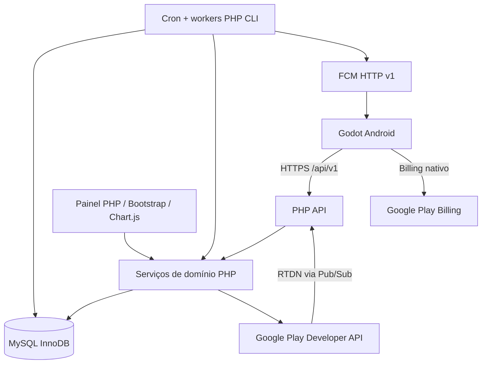

# TerraBela Farm — Especificação de MVP comercial e LiveOps

**Data:** 25/11/2026  
**Status:** proposta de implementação; não representa código entregue nem release aprovado.  
**Repositório:** https://github.com/Celsocsilva/GameTerraBelaFarm  
**Website:** https://terrabelafarm.com  
**Escopo inicial:** Android nativo, preservando compatibilidade arquitetural para iOS.

## 1. Decisões de produto e tecnologia

Decisões confirmadas: manter Godot 4.7.2 Standard/GDScript e o jogo nativo; backend administrativo e APIs em PHP; MySQL; dashboard com Chart.js; notificações pelo FCM HTTP v1, templates e histórico de campanhas, cada mensagem com destino específico no jogo; motor de regras para benefícios automáticos, engajamento e retenção; acesso Google e Facebook. O acesso visitante sem cadastro obrigatório é a diretriz de UX discutida.

Propostas para aprovação técnica: PHP 8.x em versão suportada, MySQL 8.x suportado/InnoDB, Composer, PDO, MVC modular, Bootstrap 5, DataTables com paginação no servidor, SweetAlert2, Select2 e FullCalendar quando necessários; REST JSON versionado, OpenAPI, HTTPS, workers PHP CLI e cron, fila MySQL, RBAC, GitHub Actions. Não introduzir SPA, microsserviços, Redis ou Kubernetes no MVP sem evidência de necessidade. Manter painel em light mode, responsivo, PT-BR inicialmente e preparado para inglês e espanhol. Usar versões fixadas e dependências suportadas, sem CDNs não controladas em produção.

iOS/Apple Login e e-mail OTP sem senha ficam para expansão; validar regras de loja e autenticação antes dessa etapa. A primeira publicação é Android; localização comercial e idioma são independentes. Todos os preços reais de IAP devem vir da loja da plataforma, não de conversão fixa nem do painel. Valores de benefícios, SKUs, horários e limites neste documento são propostas até aprovação do Product Owner.

## 2. Auditoria estática do estado atual

Base consultada: árvore main identificada pela API GitHub como `09001eeb1782e5b74604c960814dc4ebc484fe8a` (árvore, não SHA de commit). Leitura de README, AGENTS, políticas, contratos, arquitetura, documentação IAP, project.godot, App, Wallet, StorePurchaseService e StoreEntitlements. A árvore recursiva não estava truncada. Não foram executados builds, testes nem auditoria exaustiva do código ou serviços externos.

| Área | Evidência no repositório | Gap |
| --- | --- | --- |
| Gameplay | scripts/farming, commerce, customers, helpers, progression; smoke tests em tools | Preservar e homologar em Android real |
| Inicialização | project.godot: loading_screen.tscn e autoload App; scripts/core/app.gd tem SAVE_VERSION=1 e session_started | Integrar sessão, save, configuração e roteamento após UI pronta; não transformar App em monólito |
| Persistência | README declara integração pendente; contracts.md prevê escrita segura e migração | Save local completo + Cloud Save, restauração e sincronização |
| Economia | scripts/economy/wallet.gd: cash e gold separados, histórico local e setters de restauração | Ledger e idempotência persistentes, autoridade do servidor para operações críticas |
| Loja | scenes/ui/store/StoreScreen.tscn, scripts/ui/store/store_catalog.gd e docs/IAP_SHOP.md | Preservar UI Store V2, mapear catálogo e produtos reais |
| Compras | store_purchase_service.gd apenas UNAVAILABLE/SIMULATED; store_entitlements.gd concede em simulação | Billing nativo, validação backend, concessão real auditável, reembolso e restauração |
| Login e backend | Sem diretório de backend ou integração dedicada identificada na árvore | Identidade, API PHP, MySQL, sessões e privacidade |
| Notificações/LiveOps | Sem integração dedicada identificada na árvore | FCM, plugin Android, campanhas, regras, Remote Config, analytics |
| CI e governança | .github/workflows, agents, orchestration, docs/evidence e tools | Acrescentar gates PHP/MySQL e integração mobile; não assumir workflows verdes |

A documentação existente tem descrições de versões anteriores (por exemplo, README descreve modal com 15 ofertas, enquanto IAP_SHOP documenta Store V2 com sete; README cita farm_world como cena principal, mas project.godot usa loading_screen). Confirmar runtime antes de atualizar descrições. Não alterar mecânicas, valores, assets, cenas aprovadas ou substituir testes sem decisão registrada.

## 3. Arquitetura alvo



Monólito modular inicialmente, API e painel compartilhando serviços, com isolamento lógico de autenticação administrativa e de jogadores. Cliente nunca acessa MySQL, chave de serviço FCM ou credenciais de lojas. Painel não deve editar saldo diretamente: toda ação passa por serviço de domínio e trilha de auditoria. O jogo permanece nativo, sem WebView para gameplay.

Estrutura proposta, a ajustar com o arquiteto:
```text
backend/
  public/index.php       # front controller; único document root
  src/{Auth,Players,Saves,Economy,Billing,Config,Analytics,Campaigns,Rules,Rewards,Admin}/
  config/                # exemplos sem segredos
  database/migrations/
  bin/                   # workers/cron
  templates/             # painel PHP
  tests/
  composer.json
  .env.example
scripts/services/        # adaptadores Godot; aproveitar domínios atuais
docs/architecture/
```
Manter ambiente local, staging e produção separados; bancos, credenciais, projetos FCM e produtos de teste isolados. Configurar logs, health checks, alertas e deploy com rollback. Não expor .env, dumps, logs ou diretórios internos no webroot. Repositório público: nenhum segredo, dado pessoal real ou token deve ser versionado.

## 4. Identidade, privacidade e acesso (P0)

- Primeiro acesso: iniciar jogo como visitante; gerar identificador de instalação aleatório e estabelecer player_id no servidor quando online. Sem exigir e-mail, telefone ou senha para jogar. Sessão guest deve ter credencial segura, não apenas UUID previsível; persistir em armazenamento protegido da plataforma.
- Google via Credential Manager e Facebook Login via SDK/integração nativa compatível com Godot, após validação em spike Android. Backend valida token com provedor (assinatura quando aplicável, issuer, audience/app ID, validade, nonce/estado e subject), não aceita identidade autodeclarada pelo cliente. Identidade única por (provider, subject).
- Vincular provedores ao player_id atual mediante prova de controle de ambos; nunca unir contas apenas por e-mail igual. Tratar conflito de fazendas com escolha explícita e política aprovada, sem mesclar saldo automaticamente. Possibilitar recuperação em novo dispositivo após vinculação. Visitante que perde a credencial pode perder acesso; comunicar isso sem bloquear gameplay.
- Sessões próprias com tokens de acesso curtos e refresh rotativo/revogável, armazenamento seguro, logout por dispositivo; admin separado com MFA, RBAC (admin, operação, suporte, leitura) e auditoria. Não registrar tokens em logs.
- Solicitar notificações no contexto adequado (Android 13+), separar preferências operacionais e promocionais; permitir opt-out e respeitar a permissão do sistema. E-mail do provedor, quando disponível, não é autorização de marketing. Disponibilizar política de privacidade, termos, suporte e fluxo de exclusão de conta/dados conforme aplicável; revisar LGPD, Data Safety, regras de público infantil e SDKs antes da publicação.

## 5. Persistência e economia (P0)

Save local versionado em user:// com escrita temporária e substituição segura, recuperação de backup e migração explícita. Incluir culturas e timestamps de ciclo, inventário e caixas, banca, pagamentos pendentes, saldo cash/gold, ajudantes, níveis, missões, desbloqueios, configurações e entitlements. Não serializar árvore visual inteira. Definir limites e validar schema.

Cloud Save com snapshot, schema_version, revision e timestamps UTC do servidor. Comandos críticos com operation_id estável, base_revision e idempotência; responder conflitos sem sobrescrever cegamente dados de outro dispositivo. Validar migração de guest local para conta; guardar cópia anterior e nunca apagar save local antes de confirmar commit remoto. Relógio do servidor para expirações e benefícios; mitigar manipulação do relógio local.

Offline: manter jogabilidade local e fila de operações limitadas; definir limites de produção offline e reconciliar com regras aprovadas. Não permitir IAP, transferência ou emissão/resgate de premium offline sem confirmação. Não aceitar saldo arbitrário de snapshot. Em conflito, autoridade do servidor para moedas premium, IAP e benefícios; progresso gratuito conciliado conforme política explícita. Se não houver rede, informar estado de sincronização sem bloquear o fluxo básico.

Ledger transacional append-only com jogador, moeda (cash/gold), quantidade inteira assinada, origem, referência, idempotency_key, timestamps e saldo resultante. Atualização do ledger e saldo na mesma transação; locking/versionamento, saldo não negativo conforme regra, sem floats para dinheiro. Inventário e entitlement também idempotentes. Pagamentos na bancada só entram no saldo na coleta, conforme contrato atual; separar receita pendente de saldo disponível. Preservar Wallet como projeção/adaptador dos serviços, não usar setters para conceder IAP. Testar duplicidade, corrida e recuperação. Definir fonte, teto e sinks de moedas e controlar impacto de recompensas.

## 6. IAP e receita (P0)

Integrar Google Play Billing nativo por adaptador Platform, com StorePurchaseService real separado do modo simulado de testes. Obter ProductDetails e preço localizados da loja; exibir estados indisponível, pendente, cancelado e comprado. Catálogo interno mapeia SKU da plataforma a versão imutável de benefícios aprovada. Não habilitar compra real com preço de demonstração.

Backend recebe purchase token e contexto autenticado, consulta Google Play Developer API, verifica app/package, produto, estado, propriedade/vínculo quando disponível e transação não usada. Conceder somente após estado comprado verificado, atomicamente com registro único de token/transação e ledger/entitlements; repetir chamada retorna resultado original. Executar acknowledgement ou consumption conforme o tipo e recuperar falhas com retry; monitorar prazo de reconhecimento, tipicamente três dias após compra confirmada. Não conceder compras pendentes. Reconciliar por RTDN via Pub/Sub com autenticação do webhook, consulta à API e rotinas periódicas; tratar reembolso, revogação, restauração e política de saldo sem criar débitos arbitrários. Segredos exclusivamente no servidor. Sandbox/closed test antes de ativar catálogo; sem publicação sem autorização.

## 7. Remote Config e operação (P0)

Parâmetros versionados com defaults embarcados, schema tipado, faixas seguras, compatibilidade de versão mínima/máxima e escopo por ambiente. Painel com rascunho, prévia, publicação autorizada, changelog, rollback e feature flags (loja, manutenção, eventos). Configurações públicas cacheáveis com ETag e última versão válida offline; nunca incluir segredos.

Gerenciar tempos de culturas, capacidade de caixas, produtividade dos ajudantes, recompensas, preços virtuais e progressão apenas após aprovação econômica. Alterações não devem afetar retroativamente compras nem safras em andamento sem regra de migração. O limite inicial de sete caixas e regras atuais permanecem até aprovação. Não baixar código executável ou conteúdo que contorne review da loja.

## 8. LiveOps: campanhas, FCM e regras (P1, planejado no MVP)

### Campanhas

Templates com título, mensagem, imagem opcional, idioma, categoria, rota de destino, versão e variáveis permitidas. Campanhas com segmento, agendamento UTC e fuso local, expiração, estado rascunho/aprovada/programada/em processamento/concluída/cancelada, preview, envio de teste, estimativa de público e histórico. Segmentos por idioma, país quando legitimamente coletado, nível, atividade e comportamento; não segmentar por dados sensíveis. Suprimir contas excluídas, opt-out, tokens inválidos e públicos incompatíveis.

FCM HTTP v1 com OAuth2 por conta de serviço de privilégio mínimo, tokens por instalação, rotação e remoção de tokens inválidos. Mensagem notification + data; todos os valores de data como strings, sem dados pessoais ou segredos. Fila durável com retry/backoff e jitter para falhas transitórias, limites de concorrência, expiração e dead-letter; não reenviar erros permanentes. Aceite FCM não prova entrega; registrar enfileirada, aceita, falha, abertura e resgate; entregue apenas quando houver evidência disponível. Push não tem garantia de simultaneidade. FCM não é cobrado pelo envio, mas infraestrutura e serviços complementares podem gerar custos.

Exemplo de data:
```json
{"schema_version":"1","notification_id":"N-123","campaign_id":"C-42","route":"shop","offer_id":"GOLD_PACK_01"}
```
O identificador acima é ilustrativo. Rotas permitidas: farm, shop, tomatoes, corn, pumpkins, helpers, rewards, events. Mapear inicialmente shop para a StoreScreen existente pelo fluxo de UI, não trocar indiscriminadamente a cena do mundo; rotas ainda não implementadas permanecem desabilitadas. Validar compatibilidade por versão do cliente e disponibilidade/desbloqueio, fallback para fazenda. Plugin Android captura toque e payload de inicialização; roteador guarda destino pendente até autenticação/sincronização e UI pronta, processa uma vez, sem navegar automaticamente ao mero recebimento em foreground. Abrir benefício pelo identificador autorizado e validado pelo backend. Testar foreground, background, processo encerrado, sem permissão, offline, cold start e rota desconhecida.

### Motor de regras e benefícios

Modelo declarativo: evento ou cron + condições tipadas + ação permitida (registrar benefício, notificar ou ambos). Não executar PHP/SQL fornecido pela interface. Versionar regras, dry run, limite de público/orçamento virtual, janela de execução, cooldown e chave única (rule_version, player_id, occurrence_key). Avaliar em lotes indexados, transações curtas e locking. Registrar a concessão elegível antes de notificar; resgate transacional idempotente vinculado a player_id, com expiração e motivo. Separar concessão automática de resgate; benefício nunca depende de aceitar marketing. Regras pausáveis e auditoria.

Exemplos para validação econômica: boas-vindas, retorno após 3 dias, sete dias consecutivos, evolução de nível, primeira compra verificada, produção pronta e eventos sazonais. Evitar incentivar inatividade deliberada com recompensas progressivamente maiores. Limites iniciais propostos: três pushes promocionais por semana, horário de silêncio configurável por fuso, sem urgência artificial. Notificações operacionais separadas. A/B e grupos controle em P2.

## 9. Modelo de dados inicial (proposta)

| Tabelas | Invariantes |
| --- | --- |
| players, player_identities, player_sessions, player_devices, player_consents | Identidade provider+subject única; tokens protegidos; preferências e revogação |
| player_saves, player_save_versions, sync_operations | Revisão monotônica; operation_id único por jogador |
| wallets, economy_ledger, player_inventory, entitlements | Atomicidade; referências únicas; integridade referencial |
| iap_products, iap_transactions, iap_events | Token de compra único; estado verificável; SKU versionado |
| remote_config_versions, feature_flags | Histórico e versão publicada |
| game_events, daily_metrics | event_id único, timestamps UTC, agregação e retenção |
| notification_templates, campaigns, campaign_segments, campaign_recipients, notification_outbox, notification_events | Template versionado; envio idempotente; retry e status distintos |
| rules, rule_versions, rule_executions, reward_grants | Ocorrência única, limite, expiração, resgate único |
| admin_users, roles, permissions, admin_audit_log | Menor privilégio; trilha de alterações |

Usar migrations reversíveis quando possível, índices para player_id/last_seen_at, status/scheduled_at, event_name/occurred_at e campaign_id; paginação e agregados, retenção e anonimização conforme finalidade. Definir política de exclusão inclusive em backups; dados de auditoria/compra mantidos somente quando justificados. Backup automático criptografado e teste de restauração em staging; propor RPO/RTO e validar com responsável.

## 10. Contratos REST iniciais (nomes propostos)

| Método e rota /api/v1 | Finalidade |
| --- | --- |
| POST /auth/guest, /auth/google, /auth/facebook | Criar ou autenticar sessão |
| POST /auth/link, /auth/refresh, /auth/logout | Vinculação e ciclo de sessão |
| GET /me; DELETE /me | Perfil e fluxo de exclusão autenticado |
| GET /save; POST /sync | Snapshot e comandos versionados |
| GET /wallet; GET /inventory | Projeções de estado |
| POST /iap/verify; POST /iap/google/rtdn | Validação e eventos autenticados |
| GET /config | Configuração compatível com cliente |
| POST /events/batch | Telemetria em lote |
| POST /devices/register; DELETE /devices/{id} | Registro/revogação de instalação e FCM |
| PUT /preferences/notifications | Preferências |
| POST /notifications/{id}/open | Abertura idempotente |
| GET /rewards; POST /rewards/{id}/claim | Listar e resgatar benefícios |

Erros padronizados com code, request_id e mensagem não sensível; códigos HTTP adequados; autenticação e autorização por recurso, rate limit, payload limitado e validação server-side. Rotas administrativas separadas, CSRF em sessões de navegador, cookies Secure/HttpOnly/SameSite, prepared statements, escaping de saída e CSP. Usar OpenAPI e testes de contrato. Google Play Integrity como defesa complementar, sem tratar atestado como prova única de legitimidade.

## 11. Dashboard e telemetria

Painel PHP/Bootstrap/Chart.js: indicadores e séries por período, tabelas DataTables, filtros de país/idioma/versão, estado de fila, calendário e preview de campanha, regras e benefícios, economia, IAP, configurações, usuários e auditoria. Não usar dados fictícios em produção. Agregar no servidor; não carregar toda a base no navegador.

Eventos mínimos: first_open, session_start/end, tutorial_step/completed, crop_planted/harvested, sale_completed, level_up, helper_hired, shop_view, purchase_started/verified/refunded, notification_opened, reward_claimed. Identificador idempotente, player_id pseudônimo, app_version, UTC, propriedades permitidas; não enviar e-mail ou tokens em telemetria. Distinguir dados client-side de eventos financeiros server-side.

KPIs: DAU/MAU (jogadores únicos), retenção D1/D7/D30 por coorte com janela definida, tutorial completion, funil IAP, receita confirmada líquida de reembolsos (moeda original e conversão com fonte quando necessária), fontes/sinks cash/gold, taxa de reativação e resgate, aceites FCM, aberturas únicas / aceites elegíveis, opt-out. Atribuição de compra por janela declarada não é incremento causal; grupo controle em P2. Monitorar falhas/ANR por Android Vitals e avaliar Sentry/Crashlytics sem duplicar coleta ou violar privacidade.

## 12. Backlog executável e critérios de aceite

P0 = gate de lançamento comercial; P1 = LiveOps do MVP, preferencialmente antes do lançamento, podendo ser desativado por flag se não homologado e PO aprovar; P2 = pós-MVP. Cada item requer PR, evidência em docs/evidence, teste automatizado quando aplicável e revisão conforme AGENTS.md. IDs propostos, não Issues existentes.

| ID | Pri. | Entrega e dependência | Aceite mínimo |
| --- | --- | --- | --- |
| TBF-MVP-01 | P0 | Fundação PHP/MySQL, migrations, ambientes, CI, RBAC | API health, migrações em DB limpo, admin autenticado, zero segredos |
| TBF-MVP-02 | P0 | Identidade guest, Google, Facebook; depende 01 | Começa sem cadastro; vincula e restaura mesma fazenda; conflito não perde dados |
| TBF-MVP-03 | P0 | Save local e Cloud Save; 01/02 | Fecha/reabre, migra schema, recupera novo dispositivo e reconcilia offline |
| TBF-MVP-04 | P0 | Economy ledger e inventário; 03 | Replay e concorrência não duplicam saldo; preserva coleta e sete caixas |
| TBF-MVP-05 | P0 | Billing Android e backend, RTDN; 02/04 | Testes pendente, sucesso, replay, reembolso, ack e restauração; preço real da loja |
| TBF-MVP-06 | P0 | Remote Config; 01 | Publica, valida, faz rollback; cliente offline usa última configuração válida |
| TBF-MVP-07 | P0 | Telemetria, Chart.js, saúde e crash/ANR; 01/02 | Coortes e receita conciliáveis; métricas sem dados pessoais desnecessários |
| TBF-MVP-08 | P1 | FCM, plugin e roteador; 02/03 | Toque abre StoreScreen sem perder fazenda nos três estados do app; fallback válido |
| TBF-MVP-09 | P1 | Templates, campanhas, segmentação, fila e histórico; 07/08 | Preview, envio teste, agendamento, opt-out, retry e tracking verificados |
| TBF-MVP-10 | P1 | Motor de regras, recompensas, calendário; 04/09 | Benefício único por ocorrência, resgate seguro, dry run, pausa e limite econômico |
| TBF-MVP-11 | P0 | Tutorial, missões, balanceamento, suporte, UI e regressão | Ciclo jogável completo em Android real, sem regressão do slice; parâmetros aprovados |
| TBF-MVP-12 | P0 | Segurança, privacidade, backup, publicação controlada | Restauração testada, revisão Data Safety/exclusão, teste fechado, aceite humano |
| TBF-MVP-13 | P2 | A/B, automação avançada, OTP e iOS/Apple | Planejamento próprio após MVP e validação de loja |

Ordem: 01 → 02 → 03 → 04 → 05; 06 e 07 podem avançar em paralelo após 01; 08 → 09 → 10 após dependências; 11 ao longo das entregas; 12 como gate final. Não reescrever o gameplay em um único PR.

## 13. Definition of Done e riscos

Executar testes PHP de unidade/integração com MySQL de teste, autorização cruzada, idempotência concorrente, migrations, restore e contratos REST; smoke tests Godot atuais (farm, harvest, sales_counter, customer, helper, store_v2, HUD etc.) e validação headless; build Android e testes em aparelhos de entrada/intermediários, interrupções de rede e cold start. Validar compras reais apenas em ambiente autorizado de teste. Testar regra duplicada, FCM sem permissão, token expirado, configuração inválida, falha de fila, restauração de save e exclusão. Registrar evidência efetivamente executada, não inventar resultados.

Riscos/pendências: selecionar versões e hospedagem, plugins Android mantidos e compatíveis com Godot, contas/projetos Google e Meta, IDs de app e SKUs, permissões de serviço, política de conflito offline, público etário, limites econômicos, textos de privacidade, RPO/RTO e orçamento de operação. Realizar spikes antes de prometer integração de plataforma. Aprovar manualmente mudanças de economia, publicação e credenciais. Sem lançamento até gates P0 atendidos.

Referências existentes: [README](../../README.md), [AGENTS](../../AGENTS.md), [arquitetura](overview.md), [contratos](contracts.md), [loja IAP](../IAP_SHOP.md), [matriz mobile](../mobile/test-matrix.md), [checklist release](../releases/checklist.md). Documentação externa a validar na implementação: https://firebase.google.com/docs/cloud-messaging ; https://developer.android.com/google/play/billing ; https://developer.android.com/identity/sign-in/credential-manager ; https://developers.facebook.com/docs/facebook-login/ ; https://docs.godotengine.org/ ; https://www.chartjs.org/docs/ .
